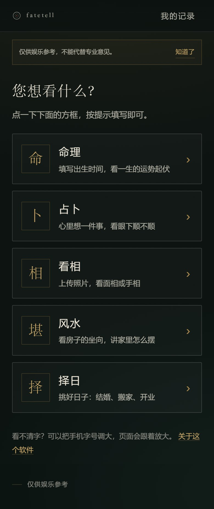
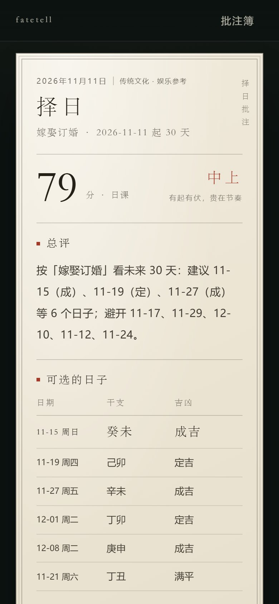

# fatetell · 相与盘

轻量的中国术数 H5 应用，按 **命、卜、相、堪舆、择日** 五门组织。

> **传统文化 · 娱乐向产品。** 不预测具体事件，不构成医疗、投资、法律、婚姻等任何决策依据。请当作一面镜子，而不是一张判决书。

前端是零依赖的原生 ES Module，后端是一个零依赖的 Node 服务：静态站点 + 典籍检索 + 确定性工具层。




---

## 快速开始

```bash
node server/server.mjs          # 默认 127.0.0.1:5173
# 或
npm start
```

打开 <http://127.0.0.1:5173>。

不需要 `npm install`（没有依赖），也没有构建步骤。Node >= 20。

## 接模型（可选）

模型只做一件事：把已经算好的结果讲成人话。它**不参与排盘**，也改不了任何数字、干支、宫位。

```bash
# macOS / Linux
export FATETELL_LLM_KEY=sk-xxxx
export FATETELL_LLM_BASE=https://api.deepseek.com/v1   # 可选
export FATETELL_LLM_MODEL=deepseek-chat                # 可选
node server/server.mjs

# Windows PowerShell
$env:FATETELL_LLM_KEY="sk-xxxx"
node server/server.mjs
```

- 默认 DeepSeek，任何 OpenAI 兼容接口都能用（Moonshot、通义、OpenAI、本地 Ollama 等）。
- 批注页底部会出现「请模型再讲一遍」，点了才调用；不点不花钱。
- 送给模型的是：排盘结果摘要 + 最多 5 条已入库引文 + 你的一句提问；不含照片。
- 结果按内容哈希缓存 30 分钟，同一页重复点不会重复计费；限流 8 次/分钟。
- 没配密钥时按钮会提示配置方法，原有模板批注不受影响。

### 照片识别（面相 / 手相，可选，需视觉模型）

「相」现在默认是**照片优先**：上传正面照 / 掌心照 → 点「看相」→ 确认发送 → 直接出批注，不再显示九项 / 十项题目。题目只作兜底，点「没有照片，或想自己逐项选」才展开。

批注里包含：总分与等级、总评与标签、六维气象、以及自动生成的一段模型解读。古籍条文已内化为本机知识库，用于生成批注，不在页面逐条列出。

- 面相：脸型、额头、眉、眼、鼻、颧、口、下巴、痣。
- 手相：左右手、掌型、掌厚、生命线、智慧线、感情线、事业线、掌丘、指长、掌纹标记。

```bash
# DeepSeek V4.1 Flash 同时支持文本与图片，一个模型即可
export FATETELL_VISION_MODEL=deepseek-flash
export FATETELL_VISION_KEY=sk-xxxx                      # 不填则复用 LLM_KEY
export FATETELL_VISION_BASE=https://api.deepseek.com/v1 # 不填则复用 LLM_BASE
```

- 换成别的供应商时，选支持图片输入的 OpenAI 兼容模型（gpt-4o-mini / qwen-vl-max / glm-4v 等）。
- 推理型模型的 `max_tokens` 要留足（当前 1400），否则思考过程会吃掉配额、正文为空；默认 `reasoning_effort=low`。
- 未配置时接口返回 503，按钮提示「未配置视觉模型」，不影响手动作答。
- 照片只在该次请求里传给模型，不落盘、不写进批注；识别结果仅作预填。
- 服务端会丢弃模型编造的字段与不存在的选项，置信度低于 45 直接返回空。

## 手机上的方向与定位

浏览器的方向传感器和地理定位都要求**安全上下文**（`https://` 或 `localhost`）。用 `http://192.168.x.x:5173` 打开时，点「启用指南针 / 取当前位置」会被拦。

两种可用方式：

**A. Android + adb（不用证书）**

```bash
adb reverse tcp:5173 tcp:5173
node server/server.mjs
```

手机浏览器打开 `http://localhost:5173` —— 对本机而言就是安全上下文。

**B. 自签 / mkcert 证书**

```bash
mkcert -install
mkcert -key-file server/certs/key.pem -cert-file server/certs/cert.pem localhost 192.168.1.10
node server/server.mjs --https --host 0.0.0.0
```

手机访问 `https://192.168.1.10:5173`。iOS 还需要把 mkcert 根证书装到设备并在「关于本机 → 证书信任设置」里打开。

---

## 五门与工具

| 门 | 方法 | 工具（`POST /api/tools/:name`） |
| --- | --- | --- |
| 命 | 四柱排盘 | `paipan` — 四柱、十神、五行、身强弱、喜用、起运、大运、流年 |
| 卜 | 小六壬 | `xiaoliuren` — 农历月日时三数起课，落六宫 |
| 相 | 面相 / 手相 / 综合相 | 前端规则引擎（六维） |
| 堪舆 | 阳宅 / 阴宅 | `yangzhai` 门·床·灶·桌；`yinzha` 坐向·来去水·形势 |
| 择日 | 黄历择日 | `zeri` — 干支、月建、建除十二神、宜忌、冲煞 |

四柱说明：年柱以立春为界，月柱以十二「节」为界，节气按太阳视黄经求解（精度到分钟）；日柱以 2000-01-01 戊午为锚点按儒略日推算，时柱由日干起。大运按阳年男顺、阴年男逆，起运以三日折一年；流年以立春为界。

```js
// 工具清单（可给 LLM 当 function calling 的 schema）
GET /api/skill
```

## 典籍库

- `knowledge/books.json`：25 部公版典籍的编目，含作者、底本、可信度、版权状态、条文计数。
- `knowledge/passages.json`：38 条已入库条文，每条带书名、篇章、`kind`（原文 / 提要）、`tags`、`source`。
- `/api/kb/search?q=生气&cat=kan`：字符二元组 + BM25-lite，带同义词扩展、标签加权与原文优先；单字查询走子串匹配。

**原文与提要严格分列**：`kind=原文` 是公版典籍的摘句，`source` 记来源；`kind=提要` 是本项目据通行说法自撰的归纳，不会冒充原文。界面不展示书目，检索结果只作为模型写批注时的依据。

### 灌整本书

```bash
mkdir -p knowledge/sources
# 每个 .md / .txt 顶部写 frontmatter
# ---
# book: shenxiang-quanbian
# chapter: 卷一·相法
# kind: 原文
# ---
node scripts/ingest.mjs knowledge/sources
```

脚本会按句读切块、写入 `knowledge/passages.generated.json`，重启服务后自动并入检索。

> 注意：只灌公版书。现代点校、注释、排印本仍在版权期内，不要整本导入。

## 目录

```
index.html
assets/app.css            设计令牌与样式
assets/js/app.js          hash 路由
assets/js/api.js          与服务通信
assets/js/data.js         面相 / 手相 / 干支 / 二十四山 / 八宅表
assets/js/engine.js       相法与八宅的规则引擎（纯函数，前后端共用）
assets/js/ui.js           命盘、雷达、罗盘、分享卡
assets/js/views/          home / library / arts / reading / combo / compass / report / misc
knowledge/                典籍编目与条文
server/server.mjs         静态 + API
server/tools.mjs          排盘、小六壬、择日、八宅
scripts/ingest.mjs        灌书管线
tests/tools.test.mjs      工具层回归
```

## 设计

墨玉为底、黄铜为界、宣纸为批注。首页是一张五门命盘，五个扇区共用一套刻度与篆意排版。
批注是一张带版框、竖排题签、朱砂「相由心生」印的纸。

## 访问控制与监测

- 站点默认关闭：未登录访问任何页面都会跳到 `/login`，用「手机号 + 6 位访问码」进入，Cookie 有效期 30 天。
- 白名单存在 `data/access.json`（已 gitignore），后台 `/admin?key=…` 管理：添加、停用、移除、查看访问码。
- 后台 key 来自环境变量 `FATETELL_ADMIN_TOKEN`，没设则自动生成到 `data/admin-token`。
- 监测：页面访问、功能点击、模型调用次数与输入/输出 tokens，按天写入 `data/stats.json`，后台可看近 14 天与今日明细。
- GitHub Pages 只放一张「受邀访问」说明页，不提供任何功能。

## 边界

- 所有输出为传统文化趣味解读，不构成医疗、投资、婚恋、法律等任何决策依据。
- 相法默认不做图像识别；照片只在本机当页对照，写入批注时丢弃。点「按照片预填」后，照片会发给一次已配置的视觉模型（`FATETELL_VISION_*`），服务端不保存，识别结果仅作预填、可逐项修改。
- 四柱的节气为近似值，日柱锚点若与万年历有出入，以历书为准。
- 典籍只收公版书；`cyber-divination` 一类无 LICENSE 或标注非商用的仓库，只作方法论参考，代码为独立实现。
- 批注存在浏览器 `localStorage`，不跨设备同步。
